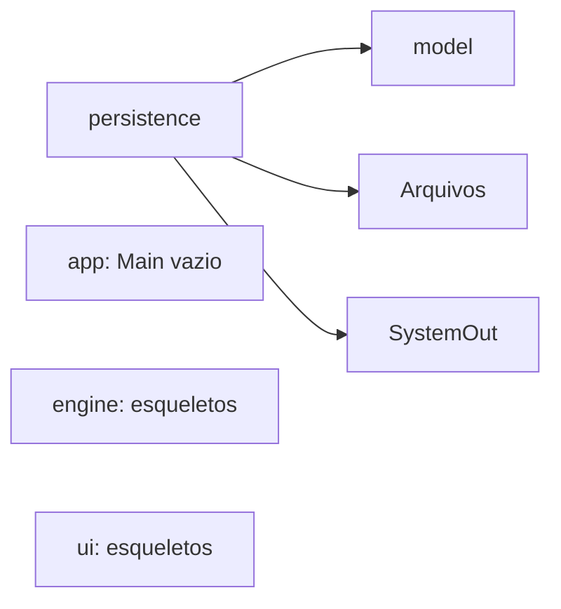
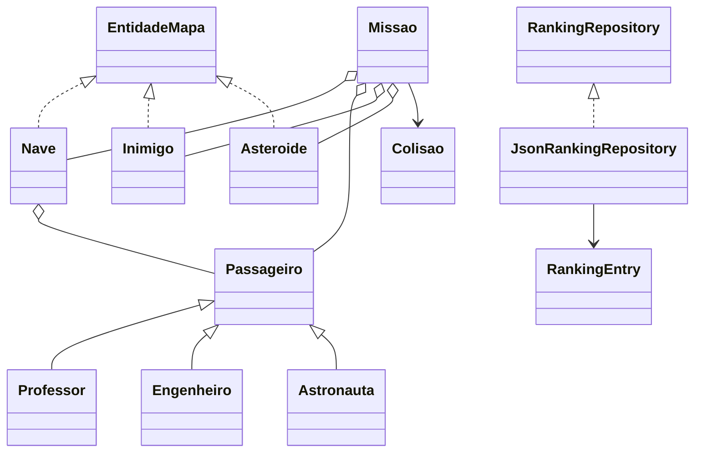
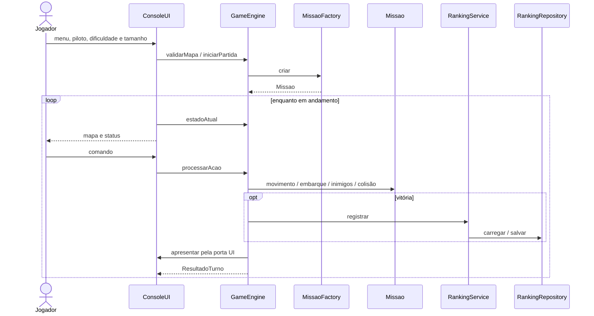

# Diagnóstico da Fase 1

## Referências e estado inicial

Estado da equipe: commit `6330869913956329dc14d8279f086d1b1b52bceb`, originalmente em `MissaoMarte/src/missao/`. Base do professor: revisão `4b43e59eacfa57798d55b68c5d018015c804193e`. O comportamento aprovado é o de `fase-0-oopuro`; a Fase 1 do professor é referência arquitetural.

O projeto tinha 22 fontes Java e compilava, mas o `Main` vazio não iniciava partida. As classes de `engine` e `ui` eram esqueletos. Não existia fluxo jogável anterior da equipe a ser demonstrado.

## Inventário anterior

| Classe ou interface | Responsabilidade existente | Dependências |
|---|---|---|
| `app.Main` | Ponto de entrada vazio | Nenhuma |
| `engine.GameEngine` | Esqueleto do motor | Nenhuma |
| `engine.MissaoFactory` | Esqueleto da fábrica | Nenhuma |
| `engine.EstatisticasMissao` | Esqueleto de estatísticas | Nenhuma |
| `model.EntidadeMapa` | Coordenadas e símbolo | Nenhuma |
| `model.Nave` | Posição, vidas, capacidade e embarque | `EntidadeMapa`, `Passageiro`, coleções Java |
| `model.Missao` | Agregação, colisão e remoção após embarque | Nave, passageiros, perigos e `Colisao` |
| `model.Passageiro` | Nome, posição, pontuação e símbolo abstratos | Nenhuma |
| `model.Professor` | Passageiro de 10 pontos, símbolo P | `Passageiro` |
| `model.Engenheiro` | Passageiro de 15 pontos, símbolo E | `Passageiro` |
| `model.Astronauta` | Passageiro de 20 pontos, símbolo T | `Passageiro` |
| `model.Asteroide` | Perigo fixo, símbolo # | `EntidadeMapa` |
| `model.Inimigo` | Perigo móvel, símbolo X | `EntidadeMapa`, `Random` |
| `model.Colisao` | Comparação de coordenadas | `EntidadeMapa` |
| `model.Dificuldade` | Quantidades e pontos | Nenhuma |
| `model.RankingEntry` | Registro imutável sem duração | Nenhuma |
| `persistence.RankingRepository` | Contrato de armazenamento | `RankingEntry`, `List` |
| `persistence.JsonRankingRepository` | Leitura/escrita JSON e reset | Contrato, arquivos, coleções, saída padrão |
| `ui.UI` | Interface vazia | Nenhuma |
| `ui.ConsoleUI` | Esqueleto | Nenhuma |
| `ui.MapaRenderer` | Esqueleto | Nenhuma |
| `ui.OpcaoMenu` | Enum vazio | Nenhuma |

## Dependências e classes antes

## Checklist e evidências anteriores

Linhas abaixo pertencem ao commit inicial, antes da movimentação.

| Item | Antes | Evidência em `MissaoMarte/src/missao/` | Depois |
|---|---|---|---|
| Domínio/motor sem entrada, saída ou UI concreta | Cumpre, com motor vazio | `engine/GameEngine.java:3`; busca sem ocorrências em model/engine | Preservado; porta UI em engine/port |
| Ações e resultados tipados | Não cumpre | `engine/GameEngine.java:3`, `ui/ConsoleUI.java:3` | Acao, ResultadoTurno, EstadoJogo e ConsoleUI |
| Portas injetadas no Main | Parcial | `persistence/RankingRepository.java:5`; `ui/UI.java:3`; `app/Main.java:4` | Main monta GameEngine com as duas portas |
| Fábrica de mapa | Não cumpre | `engine/MissaoFactory.java:3` | MissaoFactory cria cenário e valida capacidade |
| Passageiros polimórficos | Cumpre no domínio existente | `model/Passageiro.java:23`; `model/Missao.java:63` | Preservado, incluindo tipo e renderização |
| Dificuldade isolada | Cumpre estruturalmente | `model/Dificuldade.java:5` | Enum mantido; difícil corrigido |
| Comportamento original | Não cumpre | `app/Main.java:4` vazio | Console e motor completos; testes determinísticos |

Outros problemas: movimento sem limites em `model/Nave.java:40`; valores do difícil divergentes em `model/Dificuldade.java:7`; ausência de `EntidadeMapa` em `model/Passageiro.java:3`; duração ausente em `model/RankingEntry.java:3`; saída concreta na persistência em `persistence/JsonRankingRepository.java:32`, `62`, `71`; separação incorreta de strings JSON em suas linhas 96 e 120.

## Comparação e decisões

A Fase 1 do professor já contém GameSession, ações, resultados, fábrica, configuração de dificuldade, renderização e persistência. A equipe tinha parte do domínio, interface de entidade e repositório extraído, mas faltavam as conexões. Seus pacotes `missao.*` foram mantidos para preservar a identidade da implementação.

A referência arquitetural não é neutra em comportamento: usa E para embarcar, Top 10, símbolos N/*/B, desembarque, remoção de perigos e penalidade extra por colisão. Essas mudanças não foram adotadas. A equipe usa C, Top 5, símbolos originais, passageiros a bordo até o final, perigos persistentes e uma vida perdida por turno com colisão.

As quantidades 4/5/5 e pontos iniciais 30/20/45 seguem a Fase 0. No fácil, a sequência original contém dois professores e dois engenheiros; Astronauta aparece como quinto passageiro nas outras dificuldades. Três fundadores são tipos, não a quantidade por partida.

A única correção de geração aprovada é rejeitar mapas sem células suficientes e pedir outro tamanho. Um mapa de tamanho 1 tem oito células livres: fácil cabe; médio e difícil não. A base original permanece intacta, incluindo essa limitação.

Compatibilidade de ranking: leitura de `name` (original) e `nome` (equipe); duração ausente assume zero. Escrita usa campos originais e `tempoJogo`. Strings JSON são interpretadas respeitando escapes; erros de arquivo ou sintaxe chegam à aplicação, que informa o usuário. Isso evita silenciosamente apresentar uma gravação falha como sucesso.

## Fluxo antes e depois

Antes: JVM chama `Main.main`, que retorna sem criar objetos. Depois:

## Limites arquiteturais

Factory usa seleção explícita dos cinco passageiros originais, não uma estratégia extensível. O enum de dificuldade é configuração. Missao ainda separa listas de asteroides e inimigos; uma abstração Perigo não é necessária para o checklist aprovado. O motor depende de uma porta de apresentação, conforme requisito, mas pode ser testado com uma implementação sem saída. O parser JSON é específico do formato plano de ranking, não uma biblioteca JSON geral.
