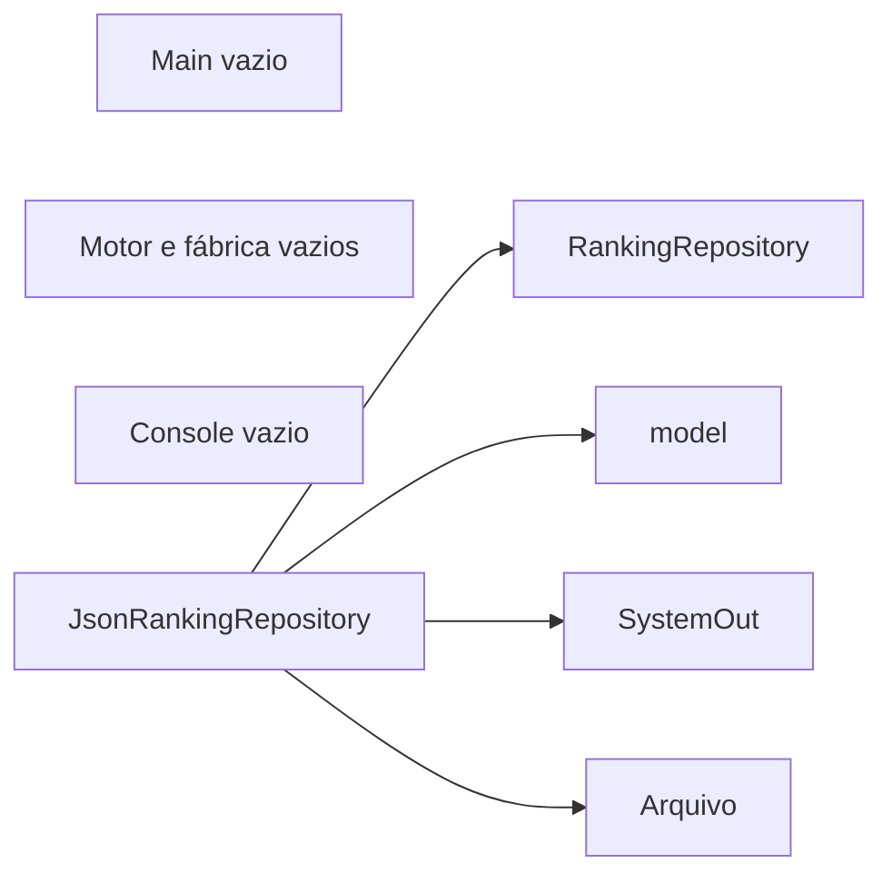
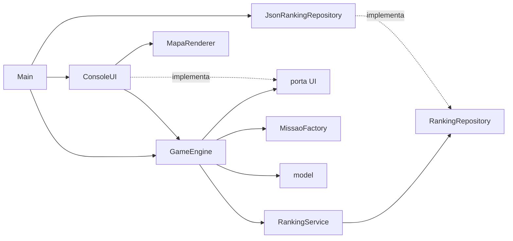
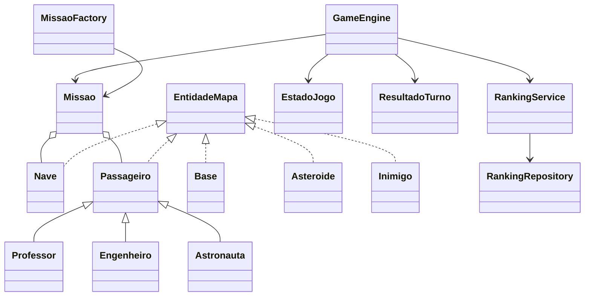

# Fase 01: tutorial da refatoração

## 1. Introdução

Esta fase completa o console da equipe mantendo o comportamento da Fase 0 do professor. O código anterior foi registrado em `6330869` e movido de `MissaoMarte/` para esta pasta. A Fase 0 importada permanece independente e intacta.

## 2. Objetivos de aprendizagem

Separar domínio, aplicação, interface e infraestrutura; usar portas e injeção de dependências; preservar regras em refatoração; testar sem console real; explicar SOLID e GRASP com classes concretas.

## 3. Conceitos teóricos

SRP separa razões para mudar: GameEngine trata turnos, MapaRenderer trata desenho, JsonRankingRepository trata arquivo e RankingService trata classificação. DIP faz a aplicação depender das portas UI e RankingRepository. LSP permite usar os três subtipos como Passageiro. ISP mantém portas focadas. OCP é parcial: renderização usa dados uniformes, mas a composição dos passageiros na fábrica é explícita.

GRASP Creator aparece em MissaoFactory; Controller em GameEngine; Information Expert em Nave/Missao; Polymorphism nos passageiros; Pure Fabrication nos serviços técnicos. EstadoJogo e ResultadoTurno protegem o estado mutável. Dificuldade é configuração, não Strategy.

## 4. Problemas encontrados no código original

No código da equipe, Main, motor, fábrica e console eram vazios. Nave não limitava movimento; difícil estava configurado com 6 passageiros e 15 pontos; Passageiro não implementava EntidadeMapa; ranking não guardava duração e o parser separava vírgulas dentro de nomes. Veja as linhas históricas no [diagnóstico](../../../docs/diagnostico.md).

O original do professor tinha funcionalidades, mas concentrava menu, regras e persistência em Main. Sua Fase 1 separou responsabilidades e também mudou regras. Por isso ela foi usada como referência de arquitetura, não como substituição do comportamento.

## 5. Arquitetura antes da transformação



O único fluxo executável da equipe era chamar Main e retornar. Não havia partida anterior funcionando para ilustrar.

## 6. Passo a passo da implementação

1. Conferir Java 17, commit inicial e revisão da base.
2. Copiar fase-0-oopuro para fase-00-original, excluindo artefatos, e preservar os fontes.
3. Mover a implementação da equipe para esta pasta. A sessão não pôde escrever em `.git`, portanto branch, git mv e commits ficaram pendentes; o conteúdo anterior está preservado em `6330869`.
4. Definir testes de dificuldade, fábrica, turnos, ranking e console. Observar falhas antes das implementações: difícil incorreto, contratos ausentes e perda de strings/duração no JSON.
5. Corrigir domínio e centralizar montagem em MissaoFactory. Validar células suficientes antes de sortear.
6. Mover UI e RankingRepository para engine/port; implementar ações, estado e resultados.
7. Completar GameEngine com a ordem original do turno. Injetar Random e Clock para testes determinísticos.
8. Separar Top 5 em RankingService e corrigir o adaptador JSON.
9. Conectar ConsoleUI e MapaRenderer pelo Main. Selecionar o JDK 17 no IntelliJ e atualizar a raiz de fontes.
10. Executar testes, comparar o cenário gerado com a base e atualizar os documentos.

## 7. Código antes e depois

Antes, GameEngine não tinha implementação:

```java
public class GameEngine {
}
```

Depois, a interface envia ações tipadas:

```java
ResultadoTurno resultado = motor.processarAcao(Acao.EMBARCAR);
EstadoJogo estado = motor.estadoAtual();
```

A regra de embarque consulta Passageiro e sua pontuação, sem testar o subtipo. O console traduz `c` em EMBARCAR; o motor não conhece teclas.

A composição fica no Main:

```java
ConsoleUI ui = new ConsoleUI(entrada, System.out, new MapaRenderer());
GameEngine motor = new GameEngine(
        new MissaoFactory(),
        new JsonRankingRepository(Path.of("ranking.json")),
        ui, new Random(), Clock.systemDefaultZone());
ui.executar(motor);
```

## 8. Explicação das alterações

Os nomes dos pacotes da equipe foram mantidos. UI mudou de pacote para permitir que engine dependa da porta sem importar o console concreto. RankingRepository também pertence à aplicação. ConsoleUI possui o loop de entrada, mas GameEngine decide movimento, embarque, pontuação, derrota, vitória e registro de resultado.

EstadoJogo contém objetos imutáveis com coordenadas e símbolos, cópias das listas e estatísticas. O renderer escolhe o primeiro objeto da célula na prioridade original: nave, passageiro, asteroide, inimigo, plataforma. Não modifica o domínio.

A fábrica conserva sequência de tipos, sorteio e posições livres. Inimigo conserva as quatro direções originais. Retornar à base não desembarca. Não foram adotados E para embarque, Top 10 ou penalidades adicionais da Fase 1 do professor.

A validação de mapas pequenos é uma correção expressamente aprovada. A leitura de JSON respeita strings e escapes; erros chegam à interface pela aplicação. Dados existentes da equipe e da Fase 0 podem ser lidos, sem importar rankings locais para o Git.

## 9. Arquitetura resultante





O diagrama de sequência da partida está no [diagnóstico](../../../docs/diagnostico.md#fluxo-antes-e-depois).

## 10. Como executar e testar

Na pasta desta fase:

```bash
export JAVA_HOME=$(/usr/libexec/java_home -v 17)
export PATH="$JAVA_HOME/bin:$PATH"
mkdir -p out
find src tests -name '*.java' -print0 | xargs -0 javac --release 17 -encoding UTF-8 -d out
java -ea -cp out missao.TodosOsTestes
java -cp out missao.app.Main
```

A suíte imprime o resultado de cada um dos seis grupos e falha com código não zero em regressões. Cenários de motor são montados com MissaoFactory substituída no teste, Random controlado e Clock injetado. Arquivos de teste ficam em diretório temporário.

A comparação adicional `missao.ComparacaoFase0` consulta o original por reflexão, sem editar seus fontes. Depois de compilar a Fase 0, execute `java -cp out:../fase-00-original/out missao.ComparacaoFase0`. Foram comparados 150 cenários e 3000 turnos de inimigos, com resultados idênticos. Essa comparação cobre geração e movimento dos inimigos; as demais regras são verificadas pelos cenários determinísticos da suíte.

Verificação manual: abrir menu, consultar ranking, cancelar reset, iniciar fácil com mapa 5, mover, embarcar com c e abortar com q. Testar tamanho 1 no médio e escolher tamanho 5 após a mensagem. Verificar fim da entrada antes e durante a partida. Vitória e derrota são reproduzidas deterministicamente na suíte, sem depender de sorte em uma partida manual.

## 11. Exercícios para os alunos

1. Explicar por que UI fica em engine/port e ConsoleUI em ui.
2. Demonstrar com um teste por que chegar à base com zero pontos é derrota.
3. Adicionar uma implementação de RankingRepository em memória e trocar somente a composição.
4. Localizar os limites de OCP na fábrica sem mudar as regras desta fase.
5. Explicar por que a Fase 1 do professor não pode substituir a equipe sem alterar o comportamento aprovado.

## 12. Conclusão

A fase transforma esqueletos em uma aplicação console executável, mantendo domínio independente de apresentação e persistência. Testes caracterizam as regras importantes e as exceções aprovadas são documentadas. Próximas fases dependem de aprovação própria; Gradle e importações posteriores não fazem parte desta entrega.
